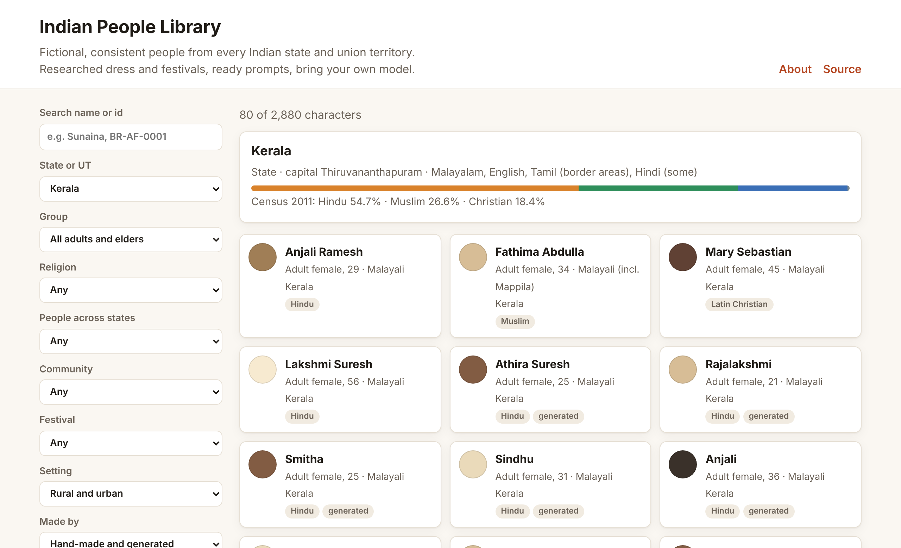

# Indian People Library

Fictional, consistent people from every Indian state and union territory, with researched regional dress, festivals and ready-to-use image prompts.

**[Browse the catalogue →](https://bandeyya.github.io/indian-people-library/)**

[](https://bandeyya.github.io/indian-people-library/)

Each character has a fixed look (skin tone on the Monk scale, face, hair, build and one signature mark), a wardrobe drawn from their own community's dress, the languages they speak and the festivals they celebrate. The prompt compiler turns a character into prompts for the image model you use, so the same person can be generated again in another outfit, scene or festival.

This is a data and prompt library. It does not generate or host images: you bring your own model.

## What is inside

- **36 region files**, one for every state and union territory. Each lists its communities with census religion shares, everyday and festive clothes for men, women and elders, accessories with their meaning (marital, religious, honour), festivals and life events, settings, occupations and naming customs. Facts come with sources, mostly state tourism and culture departments, the census, museums and community sources; each region was cross-checked against a second source, and the validator lists any item still waiting for one.
- **2,880 characters**, 20 for each group (adult men, adult women, older men, older women) in every region. Hand-made characters were reviewed one by one; generated characters (`origin: generated`) are drafts built from the hand-made characters of the same community.
- **A prompt compiler** with profiles for SDXL (default), SD 1.5, SD3, FLUX, Z-Image and long-text models. Prompts are written most important first and trimmed to each model's token budget.
- **A catalogue site** to browse and filter characters by state, group, religion, community, festival and peoples who live across several states, with a copyable prompt for each.
- **Checks** for the data, the respect rules, safety and privacy, run on every pull request.

## Quick start

You need [uv](https://docs.astral.sh/uv/) and Python 3.12 or newer.

```sh
git clone https://github.com/BanDeyya/indian-people-library
cd indian-people-library
uv run scripts/compile_prompts.py --stage candidates --region kerala    # face options for Kerala's characters
```

Then run the jobs on your own image backend (see [docs/runner.md](docs/runner.md)):

1. **candidates**: a few face options per character; pick one and save it as `reference_image` in your copy.
2. **views**: the same face from the front, the side, smiling and more.
3. **outfits**: the character in each of their clothes.
4. **festivals**: the character at each festival or rite of their own community, in clothes meant for it.

```sh
uv run scripts/compile_prompts.py --stage candidates --profile flux      # prompts for another model family
uv run scripts/compile_prompts.py --stage festivals --region bihar       # festival scenes
uv run scripts/new_character.py --region bihar --community maithil --group adult_female   # draft a new character
uv run scripts/build_site.py                                             # build the catalogue data for site/
uv run scripts/build_dataset.py                                          # JSONL dataset for Hugging Face or Kaggle
uv run scripts/check_all.py                                              # every check, before each commit
```

## Rules

- Every face is fictional: never a real person, never a real photo as a reference.
- No sexual content, nudity or glamour anywhere in this library.
- Children are never published.
- Equal respect for every region, religion and community. Sacred, honour and marital items are used only where they belong, and no character carries a caste surname.
- Label every image made with this library as AI-generated.

The full rules are in [AGENTS.md](AGENTS.md) (for people and AI agents alike), [USE-RULES.md](USE-RULES.md) and [docs/safety.md](docs/safety.md).

## Repository layout

```
data/regions/<state>.json       communities, religion mix, wardrobe and accessories, festivals, settings,
                                occupations, naming, look range, sources and what to avoid
data/characters/<state>/*.json  one file per character
data/community-index.json       peoples who live in several states (e.g. Santal, Bengali, Naga)
schema/                         JSON schemas and shared vocabulary (groups, age bands, skin tone scale)
models/<profile>.json           how to write prompts for one model family
config/default.toml             defaults; override them in a git-ignored local.toml
safety/policy.json              blocked words, negative prompts and release rules
scripts/                        validator, prompt compiler, linter, generator, site builder and checks
site/                           the catalogue (static HTML, CSS and JS)
```

## Contributing

The most useful help is a **native review**: if you belong to a state or community, tell us what is wrong, missing or disrespectful. Open an issue with the "Native review" template, or use "Report a problem" on any character in the catalogue. See [CONTRIBUTING.md](CONTRIBUTING.md) for research and code contributions.

## Citing

If you use the library in research or a product, please credit it. GitHub's "Cite this repository" button (from [CITATION.cff](CITATION.cff)) gives a ready citation.

## Licence

Code: MIT ([LICENSE](LICENSE)). Data: CC BY 4.0 ([LICENSE-DATA.md](LICENSE-DATA.md)); credit "Indian People Library" with a link to this repository.

## More documentation

- [docs/references.md](docs/references.md): where the research comes from and how sensitive subjects are handled
- [docs/safety.md](docs/safety.md): the safety policy and the reasons behind it
- [docs/runner.md](docs/runner.md): the job format and what a backend adapter needs to do
